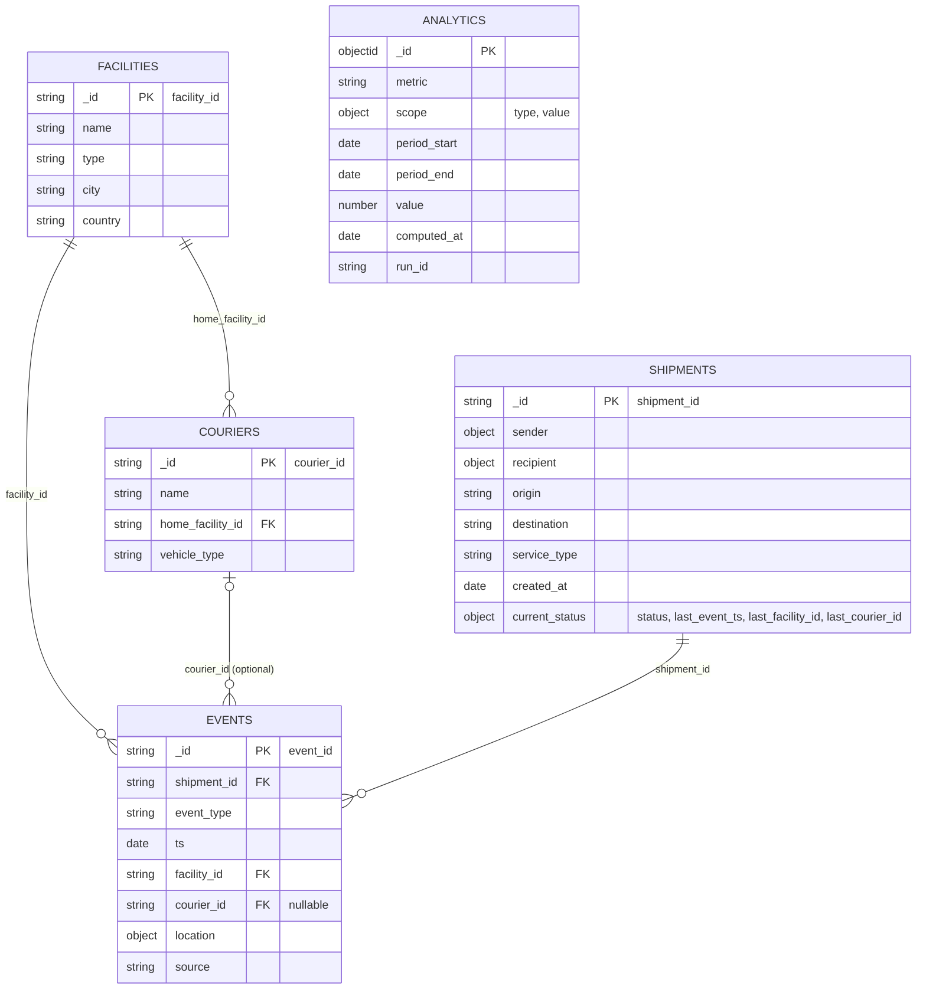

# Entity Relationship Diagram

Renders automatically on GitHub, GitLab, VS Code (Markdown preview with Mermaid support) and https://mermaid.live.

## Notes

- MongoDB has no foreign keys. `FK` marks a logical reference that the generator, consumer, and API must keep consistent.
- `shipments` to `events`: one-to-many, served by index `(shipment_id, ts)` (AP-06).
- `facilities` to `events`: one-to-many through `facility_id`, served by `(facility_id, ts)` (AP-07).
- `couriers` to `events`: optional. `courier_id` is null for events that are not courier-handled; served by the partial index `(courier_id, ts)` (AP-11).
- `facilities` to `couriers`: each courier has one home facility.
- `current_status` is an embedded object in `shipments`, a denormalized copy of the latest event, updated per micro-batch (D-10, D-11).
- `analytics` has no reference lines: `scope.value` holds a courier ID, facility ID, or service type as a plain value.